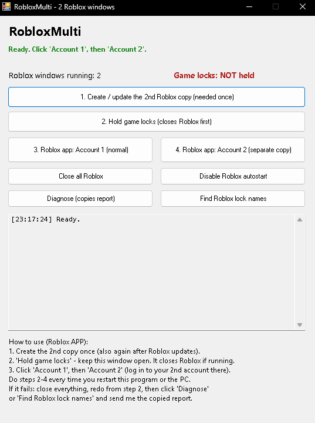
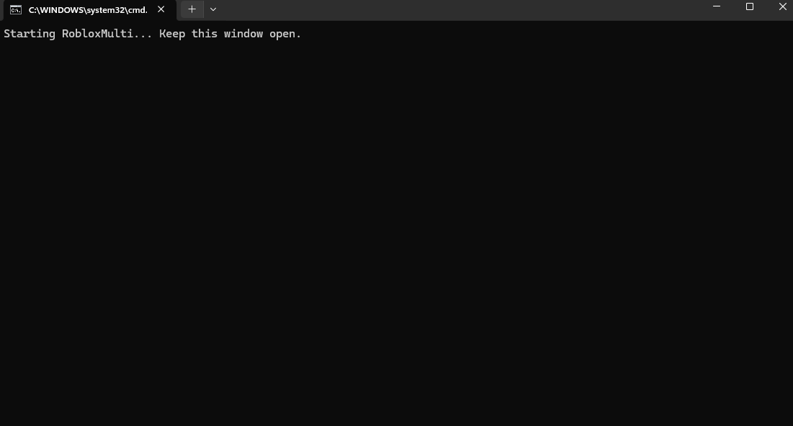

# RobloxMulti

A small Windows utility for opening two Roblox desktop app windows with separate local profiles.

**Creator:** `waftdawd.exe`

RobloxMulti can create a second local copy of the Roblox app, hold the app's singleton locks, and launch the normal app and the second copy. It also includes controls for closing Roblox processes, disabling matching Roblox startup entries, and copying a diagnostic report.

## Screenshots

## Requirements

- Windows
- The Roblox desktop app installed from Roblox's website and opened at least once
- PowerShell and .NET Framework components available with Windows

## Use

1. Download `RobloxMulti.bat` from this repository.
2. Run it and keep its Command Prompt window open while using the tool.
3. Choose **Create / update the 2nd Roblox copy**. Repeat this after Roblox updates.
4. Choose **Hold game locks**. This closes Roblox first if needed.
5. Start **Account 1**, then **Account 2**, and sign in to the second account in its window.

The second profile is stored under `%USERPROFILE%\RobloxProfile2`. The locks are released when the RobloxMulti window closes.

## Privacy and local changes

The included script works with local files, processes, the Windows clipboard, and the current user's startup registry entries. It does not include code to upload diagnostic data. The **Diagnose** and **Find Roblox lock names** buttons copy reports to the clipboard. Those reports can include Windows version, process IDs, local file paths, startup entry names and values, session information, and system object names. Review and redact a report before sharing it.

The **Close all Roblox** button force-closes processes whose names start with `Roblox`. **Disable Roblox autostart** removes matching Roblox entries from the current user's Windows Run registry key.

## Notes

This is an independent community utility and is not affiliated with Roblox. Roblox updates may change how it works. Use it only if it is compatible with the rules that apply to your Roblox account.

No license is included. All rights remain with the original author unless a license is added.

---

# RobloxMulti (Türkçe)

İki Roblox masaüstü uygulaması penceresini ayrı yerel profillerle açmaya yardımcı olan küçük bir Windows aracıdır.

**Yapımcı:** `waftdawd.exe`

RobloxMulti ikinci bir yerel Roblox uygulama kopyası oluşturabilir, uygulamanın tek örnek kilitlerini tutabilir ve normal uygulama ile ikinci kopyayı başlatabilir. Ayrıca Roblox işlemlerini kapatma, eşleşen Roblox başlangıç girdilerini devre dışı bırakma ve tanılama raporu kopyalama seçenekleri sunar.

## Gereksinimler

- Windows
- Roblox web sitesinden yüklenmiş ve en az bir kez açılmış Roblox masaüstü uygulaması
- Windows ile gelen PowerShell ve .NET Framework bileşenleri

## Kullanım

1. Bu depodan `RobloxMulti.bat` dosyasını indirin.
2. Dosyayı çalıştırın; aracı kullanırken Komut İstemi penceresini açık tutun.
3. **Create / update the 2nd Roblox copy** düğmesine basın. Roblox güncellendikten sonra bunu tekrarlayın.
4. **Hold game locks** düğmesine basın. Gerekirse önce Roblox'u kapatır.
5. Önce **Account 1**, sonra **Account 2** düğmesine basıp ikinci pencerede ikinci hesabınıza giriş yapın.

İkinci profil `%USERPROFILE%\RobloxProfile2` altında tutulur. RobloxMulti penceresi kapandığında kilitler serbest bırakılır.

## Gizlilik ve yerel değişiklikler

Sağlanan betik yerel dosyalar, işlemler, Windows panosu ve geçerli kullanıcının başlangıç kayıt defteri girdileriyle çalışır. Tanılama verilerini yükleyen bir kod içermez. **Diagnose** ve **Find Roblox lock names** düğmeleri raporları panoya kopyalar. Raporlar Windows sürümünü, işlem kimliklerini, yerel dosya yollarını, başlangıç girdilerinin ad ve değerlerini, oturum bilgilerini ve sistem nesnesi adlarını içerebilir. Raporu paylaşmadan önce gözden geçirip kişisel bilgileri silin.

**Close all Roblox**, adı `Roblox` ile başlayan işlemleri zorla kapatır. **Disable Roblox autostart**, geçerli kullanıcının Windows Run kayıt defteri anahtarındaki Roblox ile eşleşen girdileri siler.

## Notlar

Bu bağımsız bir topluluk aracıdır ve Roblox ile bağlantılı değildir. Roblox güncellemeleri çalışma şeklini değiştirebilir. Yalnızca Roblox hesabınız için geçerli kurallarla uyumluysa kullanın.

Lisans eklenmemiştir. Lisans eklenene kadar tüm haklar özgün yazarda kalır.
